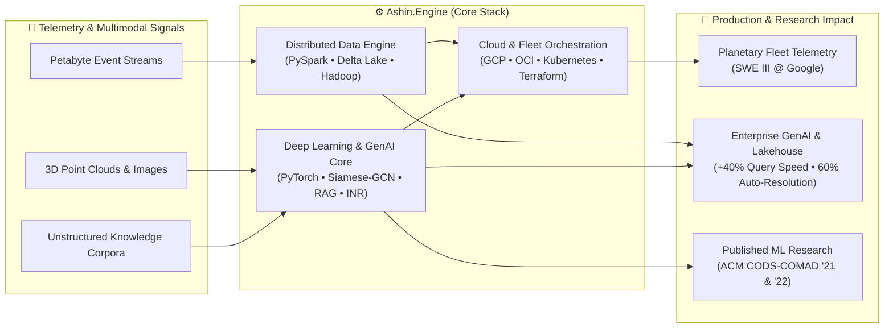
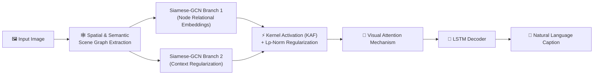

## Hey there! 👋

```bash
$ whoami
>>> Ashin Shanly — Software Engineer III @ Google | Backend & ML Engineer

$ cat /etc/education
>>> M.Tech CSE @ IIT Gandhinagar (Director's Silver Medal • 9.00 CGPA)

$ open https://ashinshanly.github.io/
>>> Launching Interactive Ubuntu Desktop Portfolio... [OK]
```
> 🖥️ **Boot Live OS Portfolio:** [ashinshanly.github.io](https://ashinshanly.github.io/) *(Interactive Bash Terminal, "Talk to Ash" AI Voice Assistant, & 3D Chess)*

---

## Alchemy

```python
class BackendAlchemy:
    def __init__(self):
        self.role = "Software Engineer III @ Google"
        self.prev = ["Member of Technical Staff @ Oracle", "Research Intern @ TCS Innovation Labs"]
        self.languages = ["Python", "Java", "C++", "JavaScript", "SQL", "PL/SQL"]
        self.databases = ["Oracle DB", "MongoDB", "Delta Lake"]
        self.skills = {
            "Backend & ML": ["Django", "PyTorch", "TensorFlow", "Keras", "GenAI / RAG"],
            "Big Data": ["Apache Spark (PySpark)", "Hadoop", "Delta Lake"],
            "Cloud & DevOps": ["GCP", "OCI", "Docker", "Kubernetes", "Terraform", "CI/CD"],
        }

    def design(self) -> str:
        return "Architecting planetary-scale distributed systems with modular elegance."

    def innovate(self) -> str:
        return "Experimenting with Petabyte Spark Pipelines, GenAI RAG & Implicit Neural Representations."

    def __str__(self) -> str:
        return "Backend Wizardry with a sprinkle of ML creativity."


ashin = BackendAlchemy()
print(ashin)
```

<details>
<summary><code>$ htop --user ashin</code> &nbsp;<i>(Click to inspect live system processes)</i></summary>

```text
PID   USER     PR  CPU%  MEM%   TIME+     COMMAND
1042  ashin    20  98.0  12.4   842:19.04 google-fleet-efficiency-engine --scale=planetary --workers=64
1108  ashin    20  95.0   9.8   612:04.22 pyspark-delta-lake-pipeline --throughput=petabyte --mode=streaming
1290  ashin    20  92.0   8.1   410:55.10 enterprise-genai-rag-service --vector-db --latency=low
1412  ashin    20  90.0   6.5   320:11.88 neural-scene-renderer --arch=siamese-gcn-inr --device=cuda:0
```
</details>

---

## System Architecture



---

## Tech Stack

```yaml
languages:
  - Python: "Clean, powerful, and my favorite weapon of choice."
  - Java: "Because strong typing = strong systems."
  - C++: "For when performance is mission-critical."
  - SQL & PL/SQL: "Speaking fluently to petabyte-scale data stores."

frameworks_and_tools:
  - Apache Spark & Delta Lake: "Petabyte-scale data engineering? Easy."
  - Docker, Kubernetes & Terraform: "Cloud orchestration simplified across GCP & OCI."
  - PyTorch, TensorFlow & Keras: "Deep learning, Computer Vision, and GenAI in production."

databases:
  - Oracle DB: "Relational databases done right."
  - MongoDB: "Flexibility for unstructured data."
```

---

## Research & Publications: Code in Action

### Image Captioning System
```python
# Siamese-GCN architecture with Kernel Activation Functions (KAF) and LSTM-Attention
from deep_learning import SiameseGCN, KernelActivation, LSTMAttention

class ImageCaptioning:
    def __init__(self):
        self.encoder = SiameseGCN(activation=KernelActivation(lp_norm=True))
        self.decoder = LSTMAttention()

    def caption(self, image):
        scene_graph = self.encoder.extract_spatial_semantics(image)
        return self.decoder.generate_caption(scene_graph)
```
> 🏆 **Published:** *9th ACM IKDD CODS and 27th COMAD Conference*  
> 🎓 **Read My Papers:** [Google Scholar](https://scholar.google.com/citations?user=Grl9bo0AAAAJ&hl=en) • [ResearchGate](https://www.researchgate.net/profile/Ashin-Shanly)

<details>
<summary><code>$ ./visualize_model.sh --arch siamese-gcn</code> &nbsp;<i>(Click to view interactive neural architecture diagram)</i></summary>


</details>

<details>
<summary><code>$ ./inspect_research.sh --all-publications</code> &nbsp;<i>(Click to expand more research)</i></summary>

```python
research_vault = [
    {
        "title": "Accelerated Implicit Neural Representation with Split Encoder & Multiscale Partitioning",
        "domain": ["Deep Learning", "Computer Vision", "3D Reconstruction"],
        "impact": "Achieved up to ~21.23% faster training speed over SOTA without reconstruction loss.",
    },
    {
        "title": "Reverse Dictionary Using an Improved CBOW Model",
        "venue": "8th ACM IKDD CODS and 26th COMAD Conference",
        "domain": ["NLP", "Deep Learning"],
        "impact": "Solved the Tip-of-the-Tongue problem by blending CBOW efficiency with RNN context.",
    },
    {
        "title": "3D Airborne LiDAR & Hyperspectral Fusion for Tree Segmentation",
        "venue": "TCS Research & Innovation Labs",
        "impact": "+18% boost in geospatial segmentation accuracy using hybrid ML + signal processing.",
    },
]
```
> 🔗 [View Citations on Google Scholar ↗](https://scholar.google.com/citations?user=Grl9bo0AAAAJ&hl=en) • [View Profile on ResearchGate ↗](https://www.researchgate.net/profile/Ashin-Shanly)
</details>

---

## What I’m Building & Exploring

```javascript
function nextBigThing() {
  const activeTracks = [
    "Planetary-scale fleet telemetry & efficiency systems @ Google",
    "Scalable Distributed Spark & Delta Lake Pipelines for petabyte-scale data",
    "Enterprise-Wide Generative AI & RAG Inference Services",
    "Real-time multiplayer chess & interactive browser experiences",
  ];

  return activeTracks.map(track => `Exploring ${track} 🚀`);
}

console.log(nextBigThing());
```

<details>
<summary><code>$ ls -la ~/interactive-playground/</code> &nbsp;<i>(Click to launch playable web apps)</i></summary>

```bash
drwxr-xr-x  ashin  staff  ubuntu-os-portfolio/   # Full Ubuntu 24.04 desktop in the browser
drwxr-xr-x  ashin  staff  lumina/                # Cosmic memory interactive visual experience
drwxr-xr-x  ashin  staff  musicsync/             # Real-time distributed audio synchronization
drwxr-xr-x  ashin  staff  chain-reaction/        # Multiplayer strategy board game
drwxr-xr-x  ashin  staff  secret-maze/           # Atmospheric dark-maze puzzle game
```
> 🎮 **Click to Play Live:** [Ubuntu OS](https://ashinshanly.github.io/) • [Lumina](https://ashinshanly.github.io/lumina/) • [MusicSync](https://ashinshanly.github.io/musicsync/) • [Chain Reaction](https://ashinshanly.github.io/chainreaction/) • [Secret Maze](https://ashinshanly.github.io/darkmaze/)
</details>

---

## My Code Philosophy

```ruby
# The laws of my codeverse:
def principles
  {
    "Keep It Clean"       => "Readable code > complex code",
    "Fail Fast"           => "Catch bugs early, ship faster",
    "Scalability Matters" => "Build for the future"
  }
end

puts principles
```

---

## Let’s Collaborate

```bash
$ connect --platform portfolio
>>> https://ashinshanly.github.io/

$ connect --platform scholar
>>> https://scholar.google.com/citations?user=Grl9bo0AAAAJ&hl=en

$ connect --platform researchgate
>>> https://www.researchgate.net/profile/Ashin-Shanly

$ connect --platform linkedin
>>> https://linkedin.com/in/AshinShanly

$ connect --platform email
>>> ashinkoottala@gmail.com
```
> 🔗 **Quick Connect:** [Portfolio](https://ashinshanly.github.io/) • [Google Scholar](https://scholar.google.com/citations?user=Grl9bo0AAAAJ&hl=en) • [ResearchGate](https://www.researchgate.net/profile/Ashin-Shanly) • [LinkedIn](https://linkedin.com/in/AshinShanly) • [Email](mailto:ashinkoottala@gmail.com)

<details>
<summary><code>$ python3 -c "import ashin"</code> &nbsp;<i>(Click for a terminal Easter Egg you can copy & run locally)</i></summary>

Click the **Copy** button in the top-right corner of the block below and paste it into your terminal:

```bash
python3 -c 'print("\n\033[1;36m⚡ ASHIN SHANLY\033[0m — SWE III @ Google | M.Tech CSE @ IITGN\n\033[0;32m➜ Portfolio:\033[0m https://ashinshanly.github.io/\n\033[0;35m➜ Scholar:\033[0m   https://scholar.google.com/citations?user=Grl9bo0AAAAJ\n\033[0;33m➜ LinkedIn:\033[0m  https://linkedin.com/in/AshinShanly\n")'
```
</details>

---

**Let's create something fun together.**
